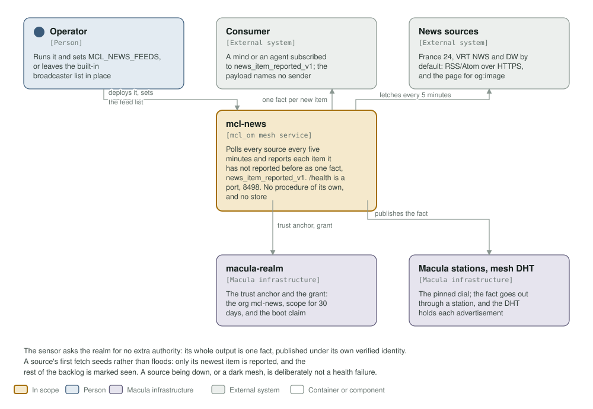
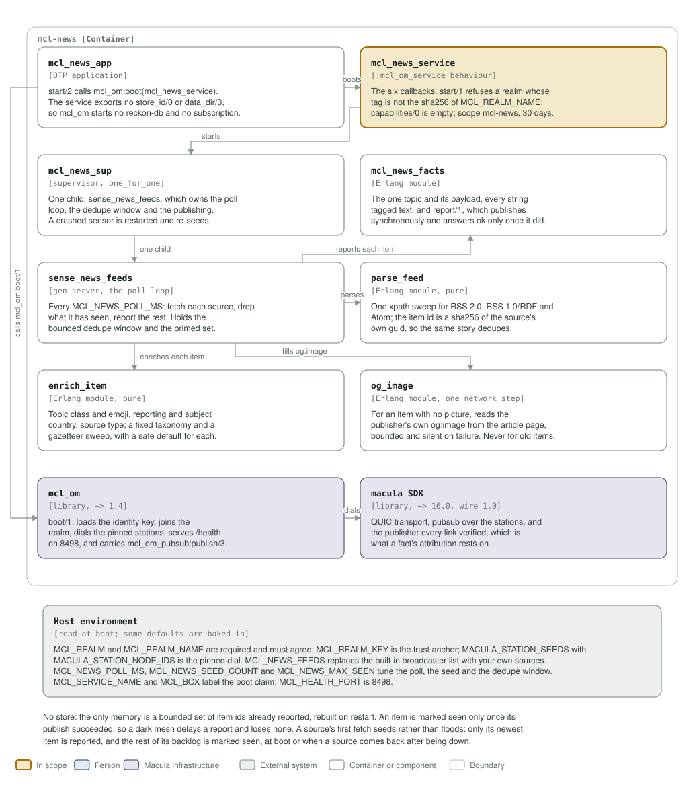

# mcl-news architecture: C4 model

*This exists so a reader can see what mcl-news talks to, and what it is made of,
without reading it.*

**Status: built and published, one sensor, no store.** The dev fleet follows
`:latest`, which only a signed `v*` tag moves. The sensor polls its sources every five
minutes, reports each item it has not reported before as one fact, offers no procedure of its own
and keeps no store.

## Level 1: system context

| Element | Kind | Role |
| --- | --- | --- |
| mcl-news | In scope | Polls every source every five minutes and reports each new item as `news_item_reported_v1` on `<realm>/mcl-news/news/wire/`. `/health` is a port, 8498. No procedures of its own and no store |
| Operator | Person | Runs it and sets `MCL_NEWS_FEEDS`, or leaves the built-in broadcaster list in place |
| Consumer | External system | A mind or an agent subscribed to `news_item_reported_v1`. The payload names no sender |
| News sources | External system | France 24, VRT NWS and DW by default: RSS/Atom over HTTPS with the system CA store, plus the article page for `og:image` |
| macula-realm | Macula infrastructure | The trust anchor and the grant: the org `mcl-news`, scope for 30 days, and the boot claim its operator sees |
| Macula stations, mesh DHT | Macula infrastructure | The pinned dial. The fact goes out through a station, and the DHT holds each advertisement |

The sensor offers no procedure of its own and asks the realm for no extra authority: its whole
output is one fact, published under its own verified identity. A source's first fetch
seeds rather than floods: only its newest item is reported and the rest of the backlog
is marked seen. A source being down, or a dark mesh, is deliberately not a health
failure.

## Level 2: containers and components

| Component | Technology | Responsibility |
| --- | --- | --- |
| `mcl_news_app` | OTP application | `start/2` calls `mcl_om:boot(mcl_news_service)`. The service exports no `store_id/0` or `data_dir/0`, so mcl_om starts no reckon-db and no subscription |
| `mcl_news_service` | the `mcl_om_service` behaviour | The six callbacks. `start/1` refuses a realm whose tag is not the sha256 of `MCL_REALM_NAME`; `capabilities/0` is empty; scope `mcl-news`, 30 days, no actions and no resources |
| `mcl_news_sup` | supervisor, `one_for_one` | One child, `sense_news_feeds`, which owns the poll loop, the dedupe window and the publishing. A crashed sensor is restarted and re-seeds |
| `mcl_news_facts` | Erlang module | The one topic and its payload, every string tagged text, and `report/1`, which publishes synchronously and answers `ok` only once the mesh took it |
| `sense_news_feeds` | `gen_server`, the poll loop | Every `MCL_NEWS_POLL_MS`: fetch each source over HTTPS (`inets` and `ssl`, fifteen second timeout), drop what it has seen, report the rest. Holds the bounded window of item ids and the primed set |
| `parse_feed` | Erlang module, pure | One xpath sweep for RSS 2.0, RSS 1.0/RDF and Atom. The item id is a sha256 of the source's own guid, so the same story dedupes across polls |
| `enrich_item` | Erlang module, pure | Topic class and emoji, reporting and subject country, source type: a fixed taxonomy plus a gazetteer sweep, with a safe default for every field |
| `og_image` | Erlang module, one network step | For an item with no picture, reads the publisher's own `og:image` from the article page. Bounded, and silent on failure. Never for an item already reported |
| `mcl_om` | library, `~> 1.4` | `boot/1`: loads the identity key, joins the realm, dials the pinned stations, serves `/health` on 8498. Carries `mcl_om_pubsub:publish/3`, which the fact goes through |
| macula SDK | library, `~> 16.0`, wire 1.0 | QUIC transport, pubsub over the stations, and the verified publisher every fact's attribution rests on |
| Host environment | read at boot | `MCL_REALM`, `MCL_REALM_NAME`, `MCL_REALM_KEY`, `MACULA_STATION_SEEDS`, `MACULA_STATION_NODE_IDS`, `MCL_NEWS_FEEDS`, `MCL_NEWS_POLL_MS`, `MCL_NEWS_SEED_COUNT`, `MCL_NEWS_MAX_SEEN`, `MCL_SERVICE_NAME`, `MCL_BOX`, `MCL_HEALTH_PORT`, `MCL_NODE_NAME`, `MCL_NODE_HOST`, `MCL_COOKIE` |

There is no store: the only memory is a bounded set of item ids already reported (4000
by default), rebuilt on restart. An item is marked seen only once its publish
succeeded, so a dark mesh delays a report and loses none. `config/sys.config.src` fixes
the org `mcl-news` and pins `pq_hybrid` as the crypto profile, without which no station
accepts the handshake. `deploy/docker-compose.yml` mounts one named volume,
`mcl-news-secrets`, for the node identity key.

**Where the station list comes from.** It is not in `config/sys.config.src`: `mcl_om` reads `MACULA_STATION_SEEDS` and `MACULA_STATION_NODE_IDS` from the environment at boot, paired index for index, so this repository pins no station and the list may be any length.

## Drawing them

`assets/c4-context.svg` and `assets/c4-components.svg` are generated by
`architecture/c4_diagrams.py` (`python3 architecture/c4_diagrams.py`), from the code
and never from this page: the callbacks in
`apps/mcl_news/src/mcl_news_service.erl`, the poll loop and dedupe window in
`sense_news_feeds.erl`, the parse, enrich and `og:image` steps beside it, the fact in
`mcl_news_facts.erl`, the deps in `rebar.config`, the org and realm settings in
`config/sys.config.src`, the health port in the `Containerfile`, and the variables
`deploy/docker-compose.yml` passes.

Two rules for the files themselves, so they render everywhere they are read (GitHub,
an IDE, `rsvg-convert`): self-contained SVG, and literal colours in plain classes
plus a `prefers-color-scheme` dark block, never CSS custom properties, which
`rsvg-convert` renders black.

The check that keeps them here is the `c4-model` job in
`.github/workflows/c4-model.yml`. It is red until both files exist and are shown,
and it stays red if either one goes missing.
